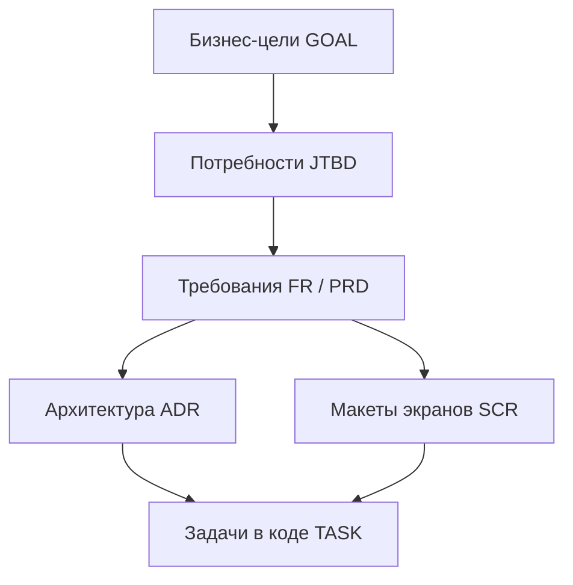

# 🗺 vellum — Проектный индекс (MOC)

Добро пожаловать в проектную базу знаний **vellum**, созданную по методологии **AIRAM**.

---

## 📊 Быстрый статус проекта
- **Текущий статус:** `READY_FOR_DEV` (см. детальный прогресс в [STATUS.md](./STATUS.md))
- **Интерактивная доска:** 🎨 [project.canvas](./project.canvas) (Визуальный дашборд фаз в Obsidian Canvas)
- **Тип продукта:** `mobile`
- **Дата старта:** `2026-09-28`

---

## 🧭 Навигация по фазам документации

### [00. Discovery & Видение](./00-discovery/)
- [00-idea-roast-and-stress-test.md](./00-discovery/00-idea-roast-and-stress-test.md) — **Протокол прожарки и стресс-теста идеи (Willingness to Pay / Big Tech Threat)**
- [00-naming-lab.md](./00-discovery/00-naming-lab.md) — **Нейминг-лаборатория и выбор бренда (5 школ нейминга)**
- [01-vision-interview.md](./00-discovery/01-vision-interview.md) — Результаты интервью с основателем и ядро идеи
- [02-stakeholders-and-goals.md](./00-discovery/02-stakeholders-and-goals.md) — Бизнес-цели (`GOAL-XX`), OKR и карта стейкхолдеров
- [03-pitch-deck.md](./00-discovery/03-pitch-deck.md) — **Презентация продукта и Pitch Deck (Obsidian Slides / Gamma)**
- [04-executive-one-pager.md](./00-discovery/04-executive-one-pager.md) — **Одностраничный инвестиционный тизер (Executive One-Pager)**

### [01. Рынок и Исследования](./01-research/)
- [01-market-and-competitors.md](./01-research/01-market-and-competitors.md) — Анализ конкурентов, бенчмаркинг и UVP
- [02-risks-and-feasibility.md](./01-research/02-risks-and-feasibility.md) — Матрица рисков и план их митигации

### [02. Требования (PRD)](./02-prd/)
- [01-product-requirements.md](./02-prd/01-product-requirements.md) — Функциональные (`FR-XX`) и нефункциональные (`NFR-XX`) требования MoSCoW
- [02-user-personas-and-jtbd.md](./02-prd/02-user-personas-and-jtbd.md) — Персоны (`PERS-XX`) и Jobs-to-be-Done (`JTBD-XX`)
- [03-traceability-matrix.md](./02-prd/03-traceability-matrix.md) — **Сквозная матрица трассируемости**
- [04-analytics-and-tracking-plan.md](./02-prd/04-analytics-and-tracking-plan.md) — **План продуктовой аналитики (Tracking Plan для PostHog/Mixpanel)**
- [05-pricing-and-feature-gating.md](./02-prd/05-pricing-and-feature-gating.md) — **Монетизация, тарифы и Feature Gating (Stripe)**
- [06-ai-evals-and-prompts.md](./02-prd/06-ai-evals-and-prompts.md) — **Оценка качества AI, бенчмарки и реестр промптов (AI Evals)**

### [03. Техстек и Архитектура](./03-tech-stack/)
- [01-architecture-overview.md](./03-tech-stack/01-architecture-overview.md) — Выбор стека и Mermaid C4 Container Diagram
- [02-infrastructure-and-costs.md](./03-tech-stack/02-infrastructure-and-costs.md) — Расчет стоимости инфры и токенов на 1k/10k MAU
- [03-security-and-compliance.md](./03-tech-stack/03-security-and-compliance.md) — Политика безопасности, секреты и комплаенс
- [04-data-models-and-schema.md](./03-tech-stack/04-data-models-and-schema.md) — **Схема БД, Mermaid ERD и Prisma/SQL модели**
- [05-api-contracts.md](./03-tech-stack/05-api-contracts.md) — **Спецификация API контрактов и эндпоинтов (OpenAPI 3.1)**
- [06-deployment-and-devops.md](./03-tech-stack/06-deployment-and-devops.md) — **CI/CD, регламент развертывания и Local Dev Environment**
- [07-observability-and-ops.md](./03-tech-stack/07-observability-and-ops.md) — **Наблюдаемость, JSON логирование, Sentry и Healthchecks**
- [adr/](./03-tech-stack/adr/) — Каталог архитектурных решений (Architecture Decision Records)

### [04. UX/UI Концепция](./04-ui-ux/)
- [01-user-flows.md](./04-ui-ux/01-user-flows.md) — Mermaid схемы пользовательских путей и экранов (`SCR-XX`)
- [02-design-system-and-tokens.md](./04-ui-ux/02-design-system-and-tokens.md) — Цветовая палитра, типографика, сетка и компоненты
- [03-ui-generator-prompts.md](./04-ui-ux/03-ui-generator-prompts.md) — Копируемые промпты для v0.dev / Lovable / bolt.new

### [05. Бэклог и Дорожная карта](./05-backlog/)
- [01-roadmap-and-milestones.md](./05-backlog/01-roadmap-and-milestones.md) — График релизов и этапы запуска (M0..M3)
- [02-epics-and-tasks.md](./05-backlog/02-epics-and-tasks.md) — Декомпозиция на эпики и задачи (`TASK-XXX`) с Acceptance Criteria
- [03-qa-and-test-strategy.md](./05-backlog/03-qa-and-test-strategy.md) — **Стратегия тестирования, Playwright E2E и предрелизный Smoke Runbook**

---

## 🛠 Руководства для команды и агентов
- [DEVELOPMENT.md](./DEVELOPMENT.md) — Инструкция первого дня по быстрому развертыванию (Day-1 Dev Guide)
- [AGENTS.md](./AGENTS.md) — Системный контекст для автономных AI кодинг-агентов

---

## 📈 Общая архитектурная схема трассируемости

