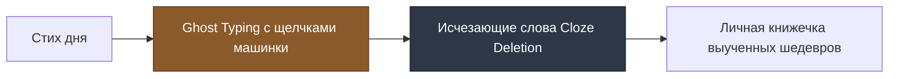

# 🎯 Vellum — Инвестиционный Pitch Deck

> **💡 Режимы демонстрации:**
> 1. **В Obsidian:** Нажмите `Ctrl/Cmd + P` ➔ введите `Start presentation` (слайды переключаются стрелками `←` `→`).
> 2. **В Gamma.app / Pitch.com:** Скопируйте готовый промпт в конце файла для генерации интерактивной веб-презентации.

---

# Vellum
### Эстетический ритуал поэзии и тренировки памяти нового поколения

> *«Type the verse. Own the memory.»*  
> *Объединяем очарование викторианской типографики с кинестетическим заучиванием стихов через тактильную печать.*

**Платформа:** iOS / Flutter | **Модель:** Freemium | 2026

---

## 1. Проблема: Цифровой шум и атрофия глубокой памяти

- **Дофаминовый перегруз:** Средний пользователь тратит 2.5+ часа в день на бессмысленный думскроллинг коротких видео.
- **Угасание концентрации:** Способность удерживать внимание на поэтическом тексте упала в 3 раза за последние 10 лет.
- **Холод цифровых читалок:** Существующие приложения со стихами — это сухие базы данных без души, тактильности и механики запоминания.
- **Потеря ритуала:** Люди мечтают о спокойных утренних и вечерних минутах наедине с мыслями, но срываются в ленты новостей.

---

## 2. Решение: Vellum — Карманное святилище поэзии



1. **Ежедневный стих дня:** Отборные шедевры мировой классики (EN + RU, Public Domain).
2. **Ghost Typing:** Печать буква в букву прямо поверх призрачного текста с виброоткликом Taptic Engine.
3. **Акустический дизайн:** Звуки винтажных печатных машинок (Underwood 1920, Hermes 3000) при каждом нажатии.
4. **Cloze Deletion (Исчезающие слова):** Научно доказанный метод интервального заучивания наизусть.
5. **Личная книжечка:** Сохранение набранных стихов в персональный рукописный фолиант.

---

## 3. Демонстрация пользовательского опыта (Core Loop)

1. **08:00 — Утренний звон:** Тихое уведомление: *«Ваша утренняя строфа ждет вас»*.
2. **08:01 — Погружение:** Открытие экрана в цвете слоновой кости (или Dark Academia). Перед глазами — 8 строк Байрона или Пушкина.
3. **08:03 — Тактильная печать:** 3 минуты медитативного набора текста. Звуки клавиш создают мгновенный фокус (ASMR-эффект).
4. **08:05 — Заучивание:** Режим с исчезающими словами помогает закрепить строфу в долговременной памяти.
5. **08:06 — Артефакт:** Стих попадает в переплет личной книги. Генерация эстетичной карточки в Instagram Stories в один клик.

---

## 4. Объем рынка (Market Size)

```
+-------------------------------------------------------------+
|  TAM: $6.2 B (Глобальный рынок Mental Wellness & Mindfulness Apps) |
|  +-------------------------------------------------------+  |
|  |  SAM: $840 M (Премиальные инди-приложения саморазвития |  |
|  |  и цифровой канцелярии: Stoic, Endel, Flora, Kinfolk)  |  |
|  |  +-------------------------------------------------+  |  |
|  |  |  SOM: $12.5 M (Доля рынка Vellum к 2029 году)    |  |  |
|  |  +-------------------------------------------------+  |  |
|  +-------------------------------------------------------+  |
+-------------------------------------------------------------+
```

- **Культурный тренд:** Взрывной рост тренда **Dark Academia** в TikTok и Pinterest (> 10 млрд просмотров).
- **Спрос на "Slow Apps":** Успех приложений с фокусом на тактильность и эстетику (Things 3, TeuxDeux, Kroma).

---

## 5. Бизнес-модель: Честный Freemium

| Тариф | Цена | Что включено |
| :--- | :--- | :--- |
| **Vellum Free** | **$0** | • 1 стих дня каждое утро<br>• Базовый Ghost Typing<br>• До 15 сохраненных стихов в книжечке<br>• 1 базовый шрифт и звук |
| **Vellum Pro (Monthly)** | **$2.99 / мес** | • Все возможности Pro с гибкой помесячной оплатой |
| **Vellum Pro (Annual)** | **$19.99 / год** | • Режим исчезающих слов (Cloze Deletion)<br>• 5 звуковых тем винтажных печатных машинок<br>• Безлимитная книжечка и кастомные стихи<br>• Экспорт карточек в высоком разрешении |
| **Vellum Patron (Lifetime)** | **$49.99 единоразово** | • Пожизненный доступ ко всем будущим коллекциям |

---

## 6. Виральный механизм (Go-To-Market & Growth)

```mermaid
flowchart TD
    U[Пользователь заучил стих] --> S[Генерация карточки "Story Card"]
    S --> I[Публикация в Instagram Stories / Pinterest / X]
    I --> W[Друзья видят изысканную типографику и водяной знак vellum.app]
    W --> D[Органическая установка из App Store]
    D --> U
```

- **Нулевой CAC на старте:** Эстетичные карточки цитат — один из самых виральных форматов в соцсетях.
- **Экспорт в 1 тап:** Оформление карточки под викторианскую открытку с тиснением даты и автора.
- **Инди-комьюнити:** Релизы на Product Hunt, Reddit (r/DarkAcademia, r/Poetry, r/iOSsetups).

---

## 7. Конкурентное преимущество (The Unfair Advantage)

| Критерий | Обычные читалки / Сайты | Telegram-каналы | Vellum |
| :--- | :---: | :---: | :---: |
| **Тактильный Ghost Typing** | ❌ Нет | ❌ Нет | ✅ **Да (Taptic Engine)** |
| **Звуки печатных машинок** | ❌ Нет | ❌ Нет | ✅ **Да (ASMR-дизайн)** |
| **Тренажер памяти (Cloze)** | ❌ Нет | ❌ Нет | ✅ **Да (Научный подход)** |
| **Отсутствие рекламы и шума** | ❌ Баннеры | ❌ Чаты/Каналы | ✅ **100% Фокус и чистота** |
| **Работа 100% оффлайн** | ⚠️ Частично | ❌ Нужен интернет | ✅ **Да ($0 затрат на инфру)** |

---

## 8. Архитектура и стек (Engineering Excellence)

- **Frontend / Client:** **Flutter (Dart)** с кастомным движком рендеринга Impeller (120 fps ProMotion).
- **Локальное хранилище:** **Isar Database / SQLite** (100% Offline-first, мгновенный старт за 300мс).
- **Аудио и тактильность:** Нативные плагины CoreHaptics (iOS) и SoundPool (с ультранизкой задержкой < 10мс).
- **Синхронизация библиотеки:** Локальный бэкап + Apple iCloud Drive.
- **Серверные расходы MVP:** **$0 / месяц** (все данные автономны на устройстве).

---

## 9. Дорожная карта (Roadmap)

- **M1 (Недели 1–4): Core Prototype & Ghost Typing**  
  Движок набора текста, звуки печатной машинки, каталог из 100 стихов (EN + RU).
- **M2 (Недели 5–8): Cloze Memory Mode & Personal Book**  
  Режим исчезающих слов, переплет книжечки, генератор виральных карточек.
- **M3 (Недели 9–12): Monetization & Soft Launch**  
  Подключение StoreKit 2 (In-App Purchases), релиз в App Store, запуск виральной петли.
- **M4 (Пострелиз): Android Expansion & UGC Import**  
  Сборка под Google Play, возможность добавления собственных стихов.

---

## 10. Команда и контакты

**Основатель и визионер:** Alex Che  
**Роль:** Product Creator & Lead Architect  
**Концепция:** Vellum — медленные цифровые ритуалы для ясного ума.

---

## 📋 Промпт для автоматической генерации презентации в Gamma.app / Pitch.com

```text
Create a stunning, minimalist 10-slide presentation for a premium mobile app called "Vellum".
Aesthetic: Victorian Modernity meets Scandinavian iOS Minimalism. Palette: Warm Ivory (#FDFBF7), Deep Charcoal Ink (#1A1A1A), Muted Antique Gold (#C5A059), and Soft Parchment Gray.
Typography: Elegant Editorial Serif headings with ultra-clean modern Sans-serif body text.

Slide 1: Title slide: "Vellum — Type the verse. Own the memory." Premium mobile sanctuary for poetry & memory training.
Slide 2: The Problem: Modern dopamine exhaustion, attention fragmentation, and lack of tactile, mindful digital rituals.
Slide 3: The Solution: Vellum — Ghost typing of daily classical verses with typewriter acoustic feedback and disappearing word memorization.
Slide 4: Product Magic: Highlighting the Taptic engine keyboard response, vintage typewriter soundscapes (Underwood, Hermes), and personal bound poetry collection.
Slide 5: The Market Opportunity: Growth of Mental Wellness & Slow Apps ($6.2B TAM), booming Dark Academia aesthetic on Pinterest/TikTok.
Slide 6: Business Model: Freemium with $2.99/mo or $19.99/yr Pro tier and $49.99 Lifetime access.
Slide 7: Viral Growth Engine: One-tap export of aesthetic quote cards designed for Instagram Stories and Twitter.
Slide 8: Competitive Edge: 100% offline-first architecture ($0 server cost), zero ads, focused cognitive training vs cluttered reading apps.
Slide 9: Technical Foundation: Flutter Impeller engine for 120fps typography, local embedded database, low-latency haptics.
Slide 10: Roadmap & Vision: MVP launch in App Store, Android expansion, user-curated poetry anthologies.
```
