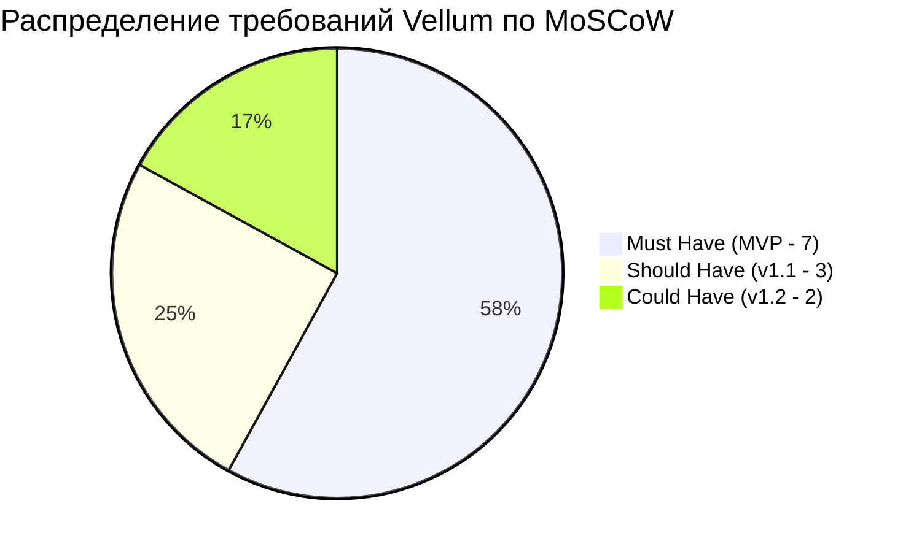

# 🔗 Матрица сквозной трассируемости: Vellum

> **Правило:**  
> Каждое требование `FR-XX` обязано связывать бизнес-цель (`GOAL-XX`), потребность персоны (`JTBD-XX`), архитектурное решение (`ADR-XXXX`), экраны интерфейса (`SCR-XX`) и задачи в бэклоге (`TASK-XXX`).

---

## 1. Сводная таблица трассируемости требований

| ID Требования | Название фичи | MoSCoW | Бизнес-цель | Персона / JTBD | Архитектурное решение (ADR) | Экраны UI | Задачи бэклога | Статус |
| :--- | :--- | :---: | :--- | :--- | :--- | :--- | :--- | :---: |
| **`FR-01`** | **Стих Дня (Daily Verse)** | Must | `GOAL-02`, `GOAL-05` | `PERS-01` / `JTBD-01` | `ADR-0002` (Offline Database & Impeller) | `SCR-01` (Daily Poem) | `TASK-102`, `TASK-104` | ⏳ Спроектировано |
| **`FR-02`** | **Ghost Typing Engine** | Must | `GOAL-02`, `GOAL-04` | `PERS-01`, `PERS-02` / `JTBD-01` | `ADR-0002` (Custom Text Layout & Impeller) | `SCR-01` (Daily Poem / Typing Mode) | `TASK-105`, `TASK-106` | ⏳ Спроектировано |
| **`FR-03`** | **Акустика & Taptic Engine** | Must | `GOAL-04` | `PERS-01` / `JTBD-01` | `ADR-0003` (Low-Latency SoundPool & CoreHaptics) | `SCR-01` (Typing Mode) | `TASK-103` | ⏳ Спроектировано |
| **`FR-04`** | **Исчезающие слова (Cloze)** | Must | `GOAL-02`, `GOAL-03` | `PERS-02` / `JTBD-02` | `ADR-0002` (Cloze Deletion Algorithm) | `SCR-02` (Memorize Practice) | `TASK-107`, `TASK-108` | ⏳ Спроектировано |
| **`FR-05`** | **Личная книжечка фолиант** | Must | `GOAL-02`, `GOAL-03` | `PERS-01`, `PERS-02` / `JTBD-03` | `ADR-0002` (Isar Local Collection Storage) | `SCR-03` (My Folio Book) | `TASK-109` | ⏳ Спроектировано |
| **`FR-06`** | **Генератор сторис-карточек** | Must | `GOAL-01` | `PERS-01` / `JTBD-04` | `ADR-0002` (Offscreen Canvas Snapshot) | `SCR-04` (Card Export Modal) | `TASK-110` | ⏳ Спроектировано |
| **`FR-07`** | **StoreKit 2 IAP Paywall** | Must | `GOAL-03` | `PERS-02` / `GOAL-03` | `ADR-0002` (StoreKit 2 & Local Feature Gating) | `SCR-05` (Vellum Pro Paywall) | `TASK-111`, `TASK-112` | ⏳ Спроектировано |
| **`FR-08`** | **Коллекция печатных машинок** | Should | `GOAL-03`, `GOAL-04` | `PERS-01` / `JTBD-01` | `ADR-0003` (Sound Theme Registry) | `SCR-06` (Settings & Themes) | `TASK-112` | 📋 Запланировано |
| **`FR-09`** | **UGC-импорт «Свой стих»** | Should | `GOAL-03` | `PERS-02` / `JTBD-05` | `ADR-0002` (User Custom Poem Parser) | `SCR-03` (Import Dialog) | `TASK-201` | 📋 Запланировано |
| **`FR-10`** | **iOS Lock Screen Widget** | Should | `GOAL-02` | `PERS-01` / `JTBD-01` | `ADR-0002` (WidgetKit Native Extension) | `SCR-07` (iOS Lock Screen) | `TASK-202` | 📋 Запланировано |
| **`FR-11`** | **iCloud Sync** | Could | `GOAL-02` | `PERS-02` / `JTBD-03` | `ADR-0002` (iCloud Drive File Sync) | `SCR-06` (Settings) | `TASK-301` | 💡 Исследуется |
| **`FR-12`** | **Кастомные шрифты** | Could | `GOAL-04` | `PERS-01` / `JTBD-04` | `ADR-0002` (Dynamic Typography Loader) | `SCR-06` (Settings) | `TASK-302` | 💡 Исследуется |

---

## 2. Диаграмма покрытия требований

---

## 3. Проверка трассируемости бизнес-целей (Goal Coverage)

- **`GOAL-01` (Виральность 10k):** Покрыта `FR-06` (Экспорт дизайнерских карточек).
- **`GOAL-02` (D7 Retention > 28%):** Покрыта `FR-01` (Стих дня), `FR-02` (Ghost typing), `FR-04` (Cloze), `FR-05` (Книжечка), `FR-10` (Виджет).
- **`GOAL-03` (Конверсия Pro > 4.5%):** Покрыта `FR-04` (Cloze уровни), `FR-07` (IAP), `FR-08` (Звуки машинок), `FR-09` (Свой стих).
- **`GOAL-04` (Превосходство UX < 8мс):** Покрыта `FR-02` (Impeller 120fps), `FR-03` (SoundPool + Taptic), `FR-08` (Акустика).
- **`GOAL-05` ($0 Серверных затрат):** Покрыта `FR-01`, `FR-02`, `FR-05` (100% Offline-first на Isar/SQLite).
