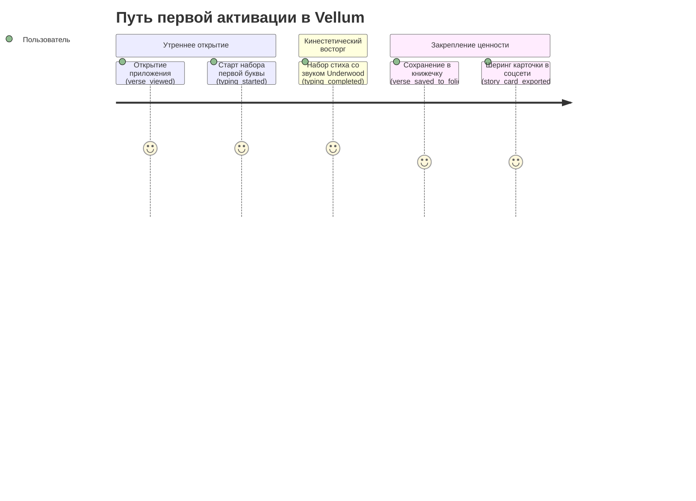

# 📊 План продуктовой аналитики и телеметрии (Tracking Plan): Vellum

> **Назначение:**  
> Данный документ определяет стандарт сбора продуктовой телеметрии (PostHog / TelemetryDeck).  
> Все события анонимизированы (Zero-PII) и привязаны к бизнес-метрикам `GOAL-01`..`GOAL-05`.

---

## 1. Конвенции именования и глобальные свойства (Super Properties)

### Конвенция нейминга: `[object]_[action]`
Все события именуются в `snake_case` в формате «объект» + «действие в прошедшем времени»:
- ✅ `verse_viewed`, `typing_completed`, `story_card_exported`
- ❌ `ClickShare`, `TypeVerse`, `start`

### Глобальные свойства сессии (Super Properties)
Отправляются с каждым событием без сбора персональных данных (Zero-PII):

| Свойство | Тип | Описание | Пример |
| :--- | :--- | :--- | :--- |
| `anonymous_id` | `string` (UUID v4) | Случайный локальный ID инсталляции | `c4a10e7b-4f99...` |
| `app_version` | `string` | Версия приложения и номер сборки | `1.0.0 (42)` |
| `os_version` | `string` | Версия iOS / Android | `iOS 19.4` |
| `locale` | `string` | Язык каталога пользователя | `ru` / `en` |
| `user_tier` | `string` | Статус подписки | `free`, `pro_monthly`, `pro_annual`, `lifetime` |
| `active_audio_theme` | `string` | Выбранный звук печатной машинки | `underwood_1920`, `hermes_3000` |
| `haptics_enabled` | `bool` | Включена ли виброотдача | `true` |

---

## 2. Каталог продуктовых событий (Event Catalog)

| Название события | Триггер (Когда отправляется) | Свойства события (Properties) | Связанная цель |
| :--- | :--- | :--- | :--- |
| **`verse_viewed`** | Открытие экрана стихотворения дня | `poem_id`: `string`<br>`author`: `string`<br>`lines_count`: `number`<br>`is_daily`: `bool` | `GOAL-02` |
| **`typing_session_started`** | Пользователь нажал первую правильную клавишу | `poem_id`: `string`<br>`mode`: `ghost_full` / `cloze` | `GOAL-02` |
| **`typing_session_completed`** | Пользователь напечатал последнюю строку | `duration_sec`: `number`<br>`mistakes_count`: `number`<br>`accuracy_pct`: `number`<br>`wpm`: `number` | `GOAL-02`, `GOAL-04` |
| **`cloze_level_started`** | Запуск тренировки памяти с исчезающими словами | `poem_id`: `string`<br>`level`: `1` / `2` / `3` / `4`<br>`hidden_words_pct`: `number` | `GOAL-02` |
| **`cloze_level_completed`** | Успешное воспроизведение скрытых строк | `level`: `number`<br>`hints_used`: `number`<br>`mastery_unlocked`: `bool` | `GOAL-02` |
| **`verse_saved_to_folio`** | Добавление стиха в «Личную книжечку» | `poem_id`: `string`<br>`total_saved_count`: `number`<br>`is_first_save`: `bool` | `GOAL-02` |
| **`story_card_exported`** | Нажатие кнопки «Поделиться» карточкой стиха | `poem_id`: `string`<br>`format`: `story_9_16` / `square_1_1`<br>`theme`: `parchment` / `dark_academia`<br>`destination`: `instagram` / `x` / `save_image` | `GOAL-01` |
| **`paywall_viewed`** | Показ экрана покупки Vellum Pro | `trigger_source`: `folio_limit_reached` / `cloze_level_3` / `audio_theme_locked` / `settings`<br>`views_count`: `number` | `GOAL-03` |
| **`subscription_started`** | Успешное оформление подписки через StoreKit | `product_id`: `pro_monthly` / `pro_annual` / `lifetime`<br>`price_usd`: `number`<br>`has_trial`: `bool` | `GOAL-03` |

---

## 3. Ключевые воронки конверсии (Core Funnels)

### Воронка первой активации (Onboarding to Aha! Moment)


### Воронка монетизации (Monetization Funnel)
```mermaid
flowchart TD
    A[Пользователь заполнил 15 стихов в книжечке ИЛИ выбрал Cloze Уровень 3] --> B[paywall_viewed]
    B --> C{Выбор тарифа}
    C -->|Месяц $2.99| D[subscription_started]
    C -->|Год $19.99 (Trial)| D
    C -->|Lifetime $49.99| D
    C -->|Закрыл крестиком| E[Возврат в Free-режим]
```
