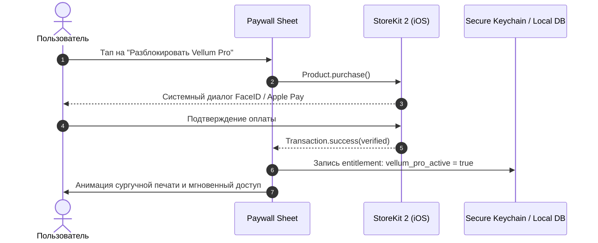

# 💳 Монетизация, тарифы и Feature Gating: Vellum

> **Назначение:**  
> Документ фиксирует ценообразование, правила платного доступа (Feature Gating) и архитектуру интеграции с Apple In-App Purchase (StoreKit 2) для мобильного приложения **Vellum**.

---

## 1. Стратегия ценообразования и бизнес-модель

- **Тип монетизации:** **Freemium** (Базовый ежедневный дзен бесплатно + Pro-подписка на глубокие практики памяти).
- **Платежный провайдер:** **Apple StoreKit 2** (нативные IAP в iOS, поддержка Apple Pay в один клик).
- **Биллинговые опции:**
  - **Pro Monthly:** **$2.99 / месяц** (для спонтанных пользователей).
  - **Pro Annual:** **$19.99 / год** (скидка 44%, 3 дня бесплатного пробного периода) — основной целевой тариф.
  - **Vellum Patron (Lifetime):** **$49.99 единоразово** (для коллекционеров и энтузиастов викторианской эстетики).
- **Целевые бизнес-метрики (`GOAL-03`):**
  - Конверсия из Free в Paid (Trial/Sub): `>= 4.5%` активных пользователей.
  - Удержание подписки (Annual Renewal Rate): `>= 65%`.
  - Валовая маржинальность: `85%` (после вычета стандартной комиссии Apple 15% по программе Small Business).

---

## 2. Сравнительная матрица тарифных планов

| Параметр | Vellum Free | Vellum Pro (Monthly / Annual) | Vellum Patron (Lifetime) |
| :--- | :--- | :--- | :--- |
| **Стоимость** | **$0** | **$2.99/мес** или **$19.99/год** | **$49.99 единоразово** |
| **Целевая аудитория** | Начинающие эстеты, утренний ритуал | Регулярные практики памяти | Коллекционеры, меценаты бренда |
| **Стих дня (Daily Verse)** | 1 стих в день | 1 стих в день + доступ к календарному архиву | Полный доступ навсегда |
| **Ghost Typing** | Полный текст (Уровень 1) | Полный текст + кастомный фокус | Полный текст |
| **Исчезающие слова (Cloze)** | Уровни 1 и 2 (до 30% скрытых слов) | **Все 4 уровня** (включая слепую печать по памяти) | Все 4 уровня |
| **Личная книжечка (Фолиант)** | **Лимит: до 15 сохраненных стихов** | **Безлимитная библиотека** | Безлимитная библиотека |
| **Звуки печатных машинок** | 1 тема: *Underwood No. 5 (1920)* | **4 темы:** *Underwood, Hermes 3000, Olympia, Calligraphy Pen* | Все темы + эксклюзивная золотая каретка |
| **UGC Импорт («Свой стих»)** | ❌ Недоступно | ✅ **Безлимитное добавление своих текстов** | ✅ Безлимитно |
| **Экспорт сторис-карточек** | Стандартное качество + лого `Vellum` | **Ultra-HD 4K + экспорт без водяного знака** | Ultra-HD 4K без водяного знака |

---

## 3. Матрица Feature Gating (Связка с `FR-XX`)

| ID Гейта | Требование (`FR-XX`) | Название функции | Free | Pro | Поведение UI при блокировке (Paywall Trigger) |
| :--- | :--- | :--- | :---: | :---: | :--- |
| **`GATE-01`** | `FR-01` | Стих Дня (текущие сутки) | ✅ | ✅ | Доступно без ограничений |
| **`GATE-02`** | `FR-02` | Базовый Ghost Typing | ✅ | ✅ | Доступно без ограничений |
| **`GATE-03`** | `FR-04` | Cloze Deletion (Уровни 3 и 4) | ❌ | ✅ | Тап по иконке уровня 3 вызывает модальное окно Vellum Pro |
| **`GATE-04`** | `FR-05` | Сохранение 16-го стиха в книжечку | ❌ | ✅ | Всплывает диалог «Ваш фолиант полон (15/15). Откройте безлимитную библиотеку с Vellum Pro» |
| **`GATE-05`** | `FR-06` | Экспорт карточки без вотермарки | ❌ | ✅ | Переключатель «Убрать подпись» заблокирован замком `PRO` |
| **`GATE-06`** | `FR-08` | Премиальные звуки машинок | ❌ | ✅ | Прослушивание 5-секундного демо в настройках ➔ кнопка разблокировки |
| **`GATE-07`** | `FR-09` | Импорт собственного стихотворения | ❌ | ✅ | Кнопка «+ Добавить свой стих» отмечена бейджем `PRO` |

---

## 4. Архитектура StoreKit 2 и локальный Entitlement Guard

- **Offline Entitlement Caching:** Статус подписки сохраняется в зашифрованном хранилище iOS Keychain. Даже без доступа к сети при открытии в самолете пользователь сохраняет Pro-привилегии на основе закешированной транзакции StoreKit.
- **Восстановление покупок:** Кнопка `Restore Purchases` проверяет активные транзакции через `Transaction.currentEntitlements`.
