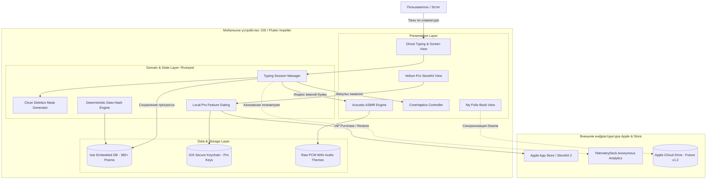
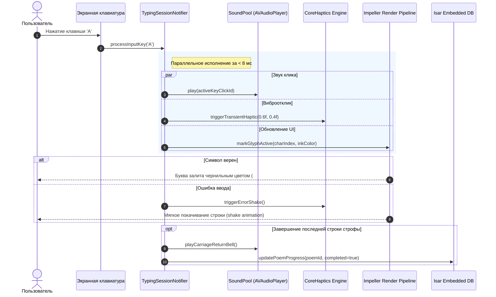

# 🏗 Архитектурный обзор и выбор технологий: Vellum

> **Цель документа:** Зафиксировать инженерные решения, структуру компонентов и диаграммы контейнеров C4 для 100% Offline-first мобильного клиента **Vellum** на базе Flutter 3.x и движка Impeller.

---

## 1. Сравнительный анализ альтернатив стека

| Слой | Рекомендуемый стек (Выбор) | Альтернатива А | Альтернатива B | Обоснование выбора |
| :--- | :--- | :--- | :--- | :--- |
| **UI Framework** | **Flutter 3.x (Dart 3)** | Swift / SwiftUI | React Native (Expo) | Полный контроль над посимвольным рендерингом (Impeller), шейдерами состаренной бумаги и кроссплатформенностью без раздувания кодовой базы. |
| **Графический рендерер** | **Impeller 2D Engine** | Skia (Legacy) | WebKit Canvas | Полное устранение шейдерных задержек (shader compilation jank), гарантированные **120 fps ProMotion** на iPhone 13 Pro+. |
| **Локальная база данных** | **Isar Database v3** | SQLite (sqflite / drift) | Hive / Realm | Высочайшая скорость чтения (< 2мс на запрос стиха), строгая статическая типизация, поддержка ACID-транзакций, нулевые серверные расходы. |
| **Аудио-движок (ASMR)** | **SoundPool / Native AVAudioPlayer** | just_audio | audioplayers (Default) | Предзагрузка аудио-сэмплов печатных машинок в несжатый PCM буфер памяти. **Латентность < 8мс** между тапом по экрану и звуковым импульсом. |
| **Тактильный отклик** | **CoreHaptics MethodChannel** | HapticFeedback (System) | vibration | Тончайшая модуляция силы и резкости импульса Taptic Engine под вес молоточка механической машинки. |
| **State Management** | **Flutter Riverpod 2.x** | BLoC | Provider | Реактивность без boilerplate-кода, декларативное управление состоянием сессии набора и кэшем прав Pro. |
| **Биллинг (IAP)** | **StoreKit 2 (in_app_purchase)** | RevenueCat | Собственный сервер валидации | Нативная интеграция без сторонних комиссий и без обязательного бэкенда для валидации чеков в MVP. |

---

## 2. Диаграмма контейнеров C4 (Mermaid C4 Container)

---

## 3. Поток выполнения сессии Ghost Typing (Sequence Diagram)

---

## 4. Архитектурные принципы Vellum

1. **Zero-Latency Principle:** Никакая операция внутри сессии набора не должна блокировать UI-поток. Воспроизведение звуков и haptics запускается в неблокирующем асинхронном режиме.
2. **100% Offline Autonomy:** Все 365+ стихотворений, звуковые файлы печатных машинок и шрифты поставляются внутри установочного бандла. Приложение готово к работе на высоте 10 000 метров без связи.
3. **Decoupled Business Logic:** Логика маскирования слов (Cloze Deletion) вынесена в чистые Dart-классы, покрываемые 100% модульными Unit-тестами без зависимости от Flutter SDK.
