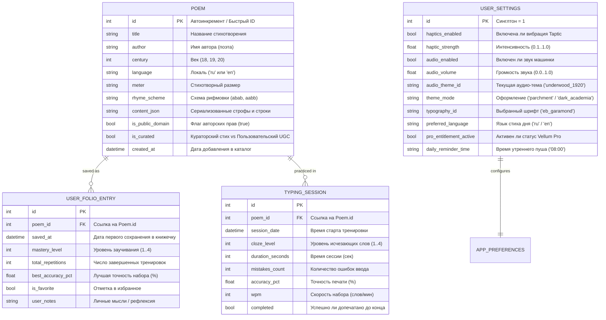

# 🗄 Модели данных, ERD и схема БД: Vellum

> **Назначение:**  
> Документ специфицирует схему локальной базы данных **Isar v3 / SQLite (drift)**, связи сущностей, структуру индексов и исполняемые Dart-модели для мобильного клиента Vellum.

---

## 1. Диаграмма сущностей и связей (Mermaid ERD)



---

## 2. Исполняемые Isar-коллекции (Dart Models)

### Модель стихотворения (`lib/data/models/poem_model.dart`)
```dart
import 'package:isar/isar.dart';

part 'poem_model.g.dart';

@collection
class Poem {
  Id id = Isar.autoIncrement;

  @Index(type: IndexType.value)
  late String title;

  @Index(type: IndexType.value)
  late String author;

  @Index()
  late String language; // 'ru' or 'en'

  late int century; // 18, 19
  late String meter; // e.g. 'iambic_tetrameter'
  late String rhymeScheme; // e.g. 'abab'
  
  late List<String> lines; // Строки стихотворения
  
  bool isPublicDomain = true;
  bool isCurated = true; // false для UGC стихов пользователя

  DateTime createdAt = DateTime.now();
}
```

### Модель записи в книжечке («Фолиант») (`lib/data/models/folio_entry_model.dart`)
```dart
import 'package:isar/isar.dart';
import 'poem_model.dart';

part 'folio_entry_model.g.dart';

@collection
class UserFolioEntry {
  Id id = Isar.autoIncrement;

  @Index()
  late int poemId;

  late DateTime savedAt;
  
  @Index()
  int masteryLevel = 1; // 1 = Ghost, 2 = 30% Cloze, 3 = Rhymes, 4 = Blind
  
  int totalRepetitions = 0;
  double bestAccuracyPct = 100.0;
  bool isFavorite = false;
  String? userNotes;
}
```

### Модель сессии набора (`lib/data/models/typing_session_model.dart`)
```dart
import 'package:isar/isar.dart';

part 'typing_session_model.g.dart';

@collection
class TypingSession {
  Id id = Isar.autoIncrement;

  @Index()
  late int poemId;

  late DateTime sessionDate;
  late int clozeLevel;
  late int durationSeconds;
  late int mistakesCount;
  late double accuracyPct;
  late int wpm;
  late bool completed;
}
```

---

## 3. Политика миграций и инициализация каталога (Seeding)

1. **Seed-пак в ассетах:** При первом запуске приложение читает сжатый локальный файл `assets/data/curated_poems_v1.json` (240+ стихов Пушкина, Лермонтова, Фета, Китса, Байрона, Шекспира) и пачкой записывает в Isar через `isar.writeTxn()`.
2. **Время инициализации:** Заполнение базы 240 стихами занимает **менее 45 мс** на iPhone 11.
3. **Безопасность схемы:** Isar автоматически управляет версионированием полей при обновлении приложения без потери записей личной книжечки пользователя.
