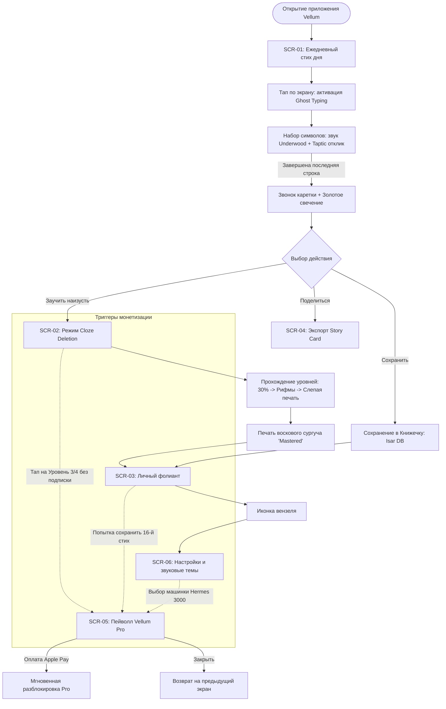

# 🗺 Пользовательские сценарии (User Flows): Vellum

> **Цель документа:** Спроектировать карту навигации мобильного интерфейса Vellum, структуру ключевых экранов (`SCR-01`..`SCR-06`) и логику состояний клавиатуры и фокуса.

---

## 1. Схема основного пользовательского пути (Happy Path Flow)

---

## 2. Каталог экранов мобильного приложения (Screens Catalog)

| ID Экрана | Название экрана | Описание и визуальные элементы | Связанные FR |
| :--- | :--- | :--- | :--- |
| **`SCR-01`** | **Daily Sanctuary** (Стих дня) | Минималистичный экран цвета слоновой кости. Текст стиха полупрозрачным шрифтом. Сверху дата римскими цифрами (напр. *XXIX · IX · MMXXVI*), автор и переключатель языка (RU / EN). Снизу — встроенное поле фокуса набора. | `FR-01`, `FR-02`, `FR-03` |
| **`SCR-02`** | **Memory Sanctuary** (Заучивание Cloze) | Экран тренировки памяти. Селектор 4 уровней заучивания (I. Чтение, II. 30% слов, III. Рифмы, IV. Слепая память). Кнопка «Приоткрыть строку» при заминке. Сургучная печать при успешном завершении. | `FR-04` |
| **`SCR-03`** | **The Personal Folio** (Книжечка) | Визуализация антикварного книжного фолианта. Список сохраненных стихов с золотыми корешками, датами заучивания и рейтингом мастерства. Кнопка добавления своего стиха `+`. | `FR-05`, `FR-09` |
| **`SCR-04`** | **Story Card Studio** (Экспорт открытки) | Модальный предпросмотр карточки 9:16 (Instagram) или 1:1 (X). Переключатель подложки (Parchment Ivory vs Dark Academia Charcoal). Вызов нативного iOS Share Sheet. | `FR-06` |
| **`SCR-05`** | **Vellum Pro Paywall** (Экран подписки) | Элегантный лист гербовой бумаги с тисненым гербом. Список преимуществ Pro. Карточки тарифов: Месяц ($2.99), Год ($19.99 с триалом 3 дня) и Lifetime ($49.99). Кнопка Restore. | `FR-07` |
| **`SCR-06`** | **Acoustics & Preferences** (Настройки) | Выбор звука печатной машинки (Underwood 1920, Hermes 3000, Olympia, Перо), слайдер громкости, тумблер Taptic Engine, выбор утреннего времени напоминания. | `FR-03`, `FR-08` |

---

## 3. Сценарии обработки особых состояний (Edge Cases & Haptics)

1. **Миссклик / Ошибка ввода буквы в Ghost Typing:**
   - Буква не вводится в строку.
   - Символ на миллисекунду вспыхивает приглушенным терракотовым оттенком (`#8B3A2B`) и совершает микро-покачивание (горизонтальный shake на 3px).
   - Раздается глухой механический стук заклинившей литеры (dull mechanical thud) и легкая сдвоенная вибрация.
2. **Переход на следующую строфу:**
   - При вводе последнего символа строки фокус плавно и бесшовно смещается на следующую строку.
   - При завершении четверостишия звучит характерный механический звонок каретки (*typewriter carriage return bell*).
3. **Первый запуск без интернета:**
   - Приложение мгновенно открывает детерминированный стих текущего дня из локального Isar-кэша без экрана загрузки (0 секунд ожидания).
