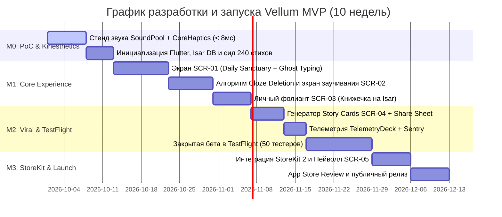

# 🗺 Дорожная карта и майлстоуны: Vellum

> **Цель документа:** Структурировать график реализации от Proof-of-Concept до публикации в Apple App Store, распределить майлстоуны M0..M3 и зафиксировать четкие критерии выхода (Exit Criteria).

---

## 1. Фазы реализации продукта (Gantt Chart)

---

## 2. Детализация контрольных майлстоунов

| Майлстоун | Название | Сроки | Ключевой результат (Deliverables) | Критерий успешности (Exit Criteria) |
| :--- | :--- | :--- | :--- | :--- |
| **`M0`** | **PoC & Кинестетика** | Недели 1–2 | Изолированный тестовый экран: звук щелчка печатной машинки + Taptic-импульс. База Isar с 240 стихами. | Задержка звука **< 8 мс**; выборка стиха из БД **< 2 мс**. Риск `RISK-02` снят. |
| **`M1`** | **Core Experience** | Недели 3–5 | Рабочий цикл: чтение стиха дня ➔ набор текста буква в букву ➔ исчезающие слова (Cloze) ➔ сохранение в книжечку. | Выполнены все критерии `FR-01`, `FR-02`, `FR-03`, `FR-04`, `FR-05`. 120 fps в Impeller. |
| **`M2`** | **Виральность & TestFlight** | Недели 6–7 | Экспорт эстетичных карточек цитат в Instagram Stories. Сборка через Fastlane в Apple TestFlight. | Успешная установка 50 тестерами. D7 Retention в тестовой когорте **> 30%**. 0 критических крэшей. |
| **`M3`** | **Биллинг & App Store Launch**| Недели 8–10 | Подключение StoreKit 2 (Vellum Pro). Экран настроек с темами звука. Прохождение модерации Apple. | Успешное одобрение в App Store. Появление первых платящих Pro-подписчиков (`GOAL-03`). |
